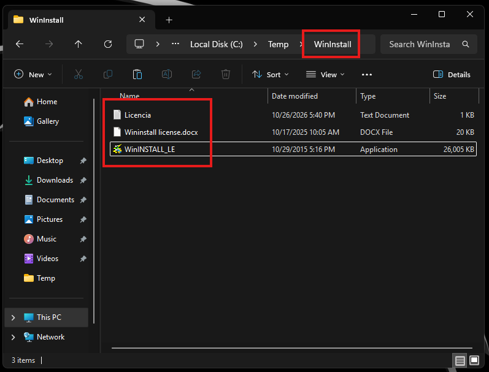

# Empaquetado de Software (.EXE a .MSI) y Despliegue por GPO en Active Directory


-2B579A?style=flat-square)


Documentación técnica de administración de sistemas Windows que recoge el ciclo completo de **reempaquetado de aplicaciones** (conversión de un instalador ejecutable `.exe` a paquete Windows Installer `.msi` mediante instantáneas del sistema) y su **distribución centralizada y desatendida** a los equipos de un dominio mediante Directivas de Grupo (GPO).

> 📄 **Versión en PDF:** Puedes consultar o descargar la memoria original de este laboratorio en [`docs/Generar-fichero-MSI.pdf`](./docs/Generar-fichero-MSI.pdf).

---

## Arquitectura y Entorno de Laboratorio

| Componente | Especificación / Valor en el Laboratorio |
| :--- | :--- |
| **Estación de Empaquetado** | Windows 11 Tiny (VM limpia sin software residual) |
| **Herramienta de Empaquetado** | Scalable WinINSTALL LE (`Discover` + `WICONSOLE`) |
| **Software Objetivo** | Notepad++ v8.9.8.1 (x64) |
| **Controlador de Dominio** | `WS25DC1.mss.loc` (Dominio: `mss.loc`) |
| **Recurso Compartido Red** | `\\ws25dc1\dato$\MSI\notepad++.msi` (Carpeta oculta) |
| **Unidad Organizativa (OU)** | `Equipos` |
| **Directiva de Grupo (GPO)** | `Install Notepad` |

---

## Estructura del Repositorio

```text
ad-gpo-msi-deployment/
├── README.md                      # Documentación técnica paso a paso
├── docs/
│   └── Generar-fichero-MSI.pdf    # Memoria original del proyecto en PDF
└── img/                           # Capturas de pantalla del laboratorio
```

---

## Fase 1: Preparación del Entorno de Empaquetado

Para evitar que el paquete `.msi` capture cambios irrelevantes de otros programas en segundo plano, el empaquetado se realiza sobre una máquina virtual limpia con **Windows 11 Tiny**.

1. Creamos el directorio de trabajo `C:\Temp\WinInstall` y copiamos en su interior el instalador `WinINSTALL_LE.exe` junto con los archivos de licencia.



2. Ejecutamos `WinINSTALL_LE.exe` y completamos el asistente de instalación introduciendo los datos de registro requeridos.


3. Tras finalizar la instalación, nos dirigimos a `C:\Program Files (x86)\Scalable\WinINSTALL\Bin` y creamos accesos directos en el escritorio para las dos herramientas principales:
   * **`Discover.exe`**: Asistente para capturar el estado del sistema antes y después de instalar una aplicación.
   * **`WICONSOLE.exe`**: Consola de administración para editar, consolidar y comprimir paquetes `.msi`.


4. Copiamos en el escritorio de la máquina el instalador original de **Notepad++** (`npp.8.9.8.1.Installer.x64.exe`).

---

## Fase 2: Captura de Instantáneas (*Before / After*) con Discover

El método de empaquetado por instantáneas (*snapshot*) compara los archivos y claves del registro de Windows antes y después de una instalación para generar un paquete `.msi` equivalente.

1. Ejecutamos **WinINSTALL LE Discover** para iniciar el asistente de creación de paquetes.


2. Definimos el nombre de la aplicación (`Notepad`) y establecemos la ruta de destino dentro de `C:\Program Files (x86)\Scalable\WinINSTALL\Bin\Packages\Notepad\`.


3. En **Drive Selection**, seleccionamos la unidad `C:` (`[-c-]`) y la añadimos a *Drives to Scan* para monitorizar todos los cambios realizados en el disco del sistema.


4. Creamos también un acceso directo en el escritorio hacia `C:\Program Files (x86)\Scalable\WinINSTALL\Bin\Packages` para acceder rápidamente a los paquetes generados.


5. El asistente realiza la instantánea inicial (**Before Snapshot**). Al completarse, nos indica que ya podemos lanzar el instalador de la aplicación.


6. Seguimos el orden estricto de ejecución:
   1. Ejecutamos `npp.8.9.8.1.Installer.x64.exe` y completamos la instalación de Notepad++.
   2. Volvemos a ejecutar **Discover** para que realice la instantánea final (**After Snapshot**) y calcule las diferencias.


7. Al finalizar la comparación, Discover muestra la ventana **Conversion Successful**, confirmando que los cambios se han convertido correctamente a formato Windows Installer.


8. Verificamos en `Bin\Packages\Notepad` que se han generado los directorios capturados (`Program Files`, `ProgramData`, `Users`, `Windows`), el fichero `.msi`, el archivo de configuración `.nai` y las entradas de registro `.reg`.


---

## Fase 3: Consolidación y Compresión del Paquete en WICONSOLE

1. Abrimos **WICONSOLE**, hacemos clic derecho sobre **Windows Installer Packages** > **Import Package** y seleccionamos el fichero `.msi` generado tras el *After*.


2. Al importar el paquete, WICONSOLE visualiza su contenido y crea una carpeta de trabajo con el `.msi` y su archivo índice `.MXI`.


3. Copiamos dentro de esta carpeta de trabajo todos los directorios y ficheros auxiliares generados durante el proceso de **Discover** (`Program Files`, `ProgramData`, `Users`, `Windows`, `Notepad.nai` y `Notepad.reg`) para asegurarnos de incluir todos los recursos de la aplicación.


4. Hacemos clic derecho sobre el paquete **Notepad** dentro de WICONSOLE y pulsamos en **Compress...** para empaquetar todos los recursos externos dentro de un único archivo `.msi` autocontenido.


5. Como resultado obtenemos el instalador definitivo `notepad++.msi` (~10,6 MB), listo para ser distribuido por red sin depender de carpetas externas.


---

## Fase 4: Validación Local del Paquete

Antes de desplegar el paquete en el dominio, ejecutamos `notepad++.msi` en un equipo cliente Windows limpio. Comprobamos que la instalación finaliza sin errores y que **Notepad++** se ejecuta correctamente.


---

## Fase 5: Despliegue Automatizado mediante GPO en Active Directory

1. En el Controlador de Dominio (`WS25DC1`), abrimos **Group Policy Management** (`gpmc.msc`) y creamos una nueva GPO llamada **`Install Notepad`**.


2. Creamos la carpeta local `C:\Datos\MSI`, depositamos el archivo `notepad++.msi` en su interior y compartimos la carpeta `Datos` como recurso oculto de red bajo el nombre **`Dato$`** (con permisos de lectura para los equipos del dominio).


3. Editamos la GPO **`Install Notepad`** y configuramos la instalación de software por equipo:
   * Navegamos a `Computer Configuration > Policies > Software Settings > Software installation`.
   * Añadimos el paquete apuntando siempre a la **ruta de red UNC** (`\\ws25dc1\dato$\MSI\notepad++.msi`) —nunca a la ruta local `C:\`— y seleccionamos el método de despliegue **Assigned**.


4. Habilitamos la espera de red en el arranque para garantizar que el equipo cliente procese la GPO y descargue el `.msi` antes de mostrar el inicio de sesión:
   * Ruta: `Computer Configuration > Policies > Administrative Templates > System > Logon`
   * Directiva: **Always wait for the network at computer startup and logon** → **Enabled**.


5. Finalmente, vinculamos la GPO **`Install Notepad`** a la Unidad Organizativa **`Equipos`** para que se aplique automáticamente en el próximo reinicio de las máquinas cliente.


---

## Buenas Prácticas Aplicadas

* **Uso de rutas UNC (`\\servidor\recurso$\...`):** Indispensable en GPOs de instalación de software, ya que los equipos cliente resuelven la ruta a través de la red y no sobre su propio disco local `C:`.
* **Recurso compartido oculto (`Dato$`):** El símbolo `$` al final oculta la carpeta al explorar la red desde el explorador de archivos, evitando accesos accidentales de usuarios finales.
* **Espera de red síncrona:** Activar *Always wait for the network* evita que Windows omita la instalación del `.msi` durante el arranque rápido antes de inicializar la tarjeta de red.

---

## Autor

* **Nicolas Guañuna**
